# Reload Monitor

Schlankes, selbst gehostetes **Netzwerk-Monitoring im Stil von PRTG** – mit einem **Map-Editor, der sich wie draw.io bedienen lässt**.
PHP 8 + SQLite + Vanilla JS, keine Build-Tools, kein Framework.

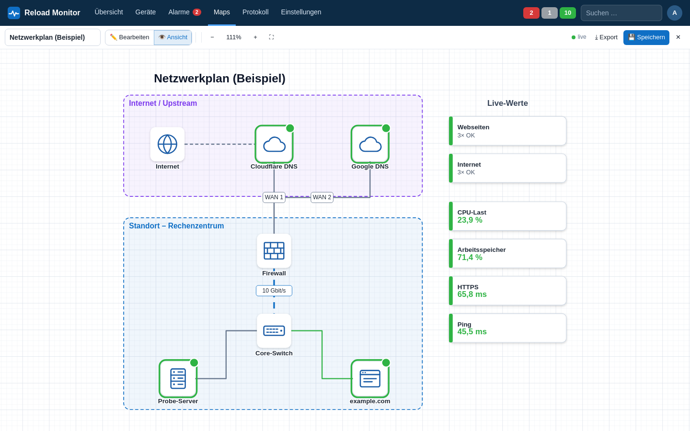

## Funktionen

- **Objektbaum wie PRTG:** Root → Probe → Gruppen (beliebig tief) → Geräte → Sensoren → Kanäle
- **Status-Logik wie PRTG:** Fehler / Warnung / bestätigt / unbekannt / OK / pausiert, schlimmster Status vererbt sich nach oben, Retry (1. Fehlschlag = Warnung, 2. = Fehler), Warn-/Fehlergrenzen, Abhängigkeiten (Master-Sensor), Alarme bestätigen, Pausieren
- **Sensortypen:** Ping, HTTP(S) (Statuscode, Schlüsselwort), TCP-Port, DNS, SSL-Zertifikatslaufzeit, HTTP-JSON-Wert (beliebige API), HTTP-Push, **SNMP System** (CPU/RAM/Laufwerke/Laufzeit/pf-States), **SNMP Traffic** (Interface ein/aus, Auslastung, Link), **SNMP Wert (OID)**, **FRITZ!Box (TR-064)**, **Windows-Agent**, CPU / RAM / Speicherplatz der Probe
- **Netzwerkscanner:** Netze (z. B. `192.168.1.0/24, 10.0.0.1-50`) scannen → Ping, ~30 Ports, Hostname, MAC/Hersteller, Web-Titel → Gerätetyp wird erkannt (FRITZ!Box, pfSense/OPNsense, Windows, DC, Linux, Proxmox, NAS, Drucker …) und Geräte mit passenden Sensoren per Klick übernommen
- **Gerätevorlagen:** Windows-Server, Domänencontroller, Linux, pfSense (Web-Port frei wählbar, z. B. 4444), FRITZ!Box, FRITZ!Repeater, Switch, Proxmox, NAS, Drucker, Webseite
- **Auto-Discovery** für einzelne Hosts (gleiche Erkennung wie der Scanner)
- **Weboberflächen per Klick öffnen:** HTTP(S)-Sensoren und Web-Ports haben ein ↗, Geräte einen „Öffnen“-Button (eigene URL hinterlegbar)
- **Kanäle:** alle Zusatzwerte eines Sensors (z. B. Download/Upload, RAM %, Frei C: %) mit eigenem Verlauf; in Maps als Wert einer Status-Kachel wählbar
- **Icons:** über 45 mitgelieferte Geräte-Icons + **eigene Icons hochladen** (SVG/PNG/JPG/WebP)
- **Graphen** (1 h / 24 h / 7 T / 30 T) mit Grenzwert-Linien, Verfügbarkeit, Ø/Min/Max
- **Benachrichtigungen:** E-Mail, Telegram, Webhook (JSON), ntfy-Push – je für Fehler / Warnung / wieder OK
- **Maps (draw.io-Bedienung):** Formen, Zonen, 20 Netzwerk-Icons, Geräte/Gruppen/Sensoren per Drag & Drop mit Live-Status, Verbinder (gerade/orthogonal/kurvig) mit Wegpunkten, Linien färben sich nach Status (zweifarbig wie PRTG), Zoom/Pan, Raster & Hilfslinien, Mehrfachauswahl, Ausrichten/Verteilen, Undo/Redo, Copy/Paste, Export PNG/SVG/JSON, **öffentlicher Link für NOC-Wand**
- **Benutzer & Rollen:** Administrator / Nur-Lesen, CSRF-Schutz, Passwort-Hashing
- **Sicherheit:** Zwei-Faktor-Anmeldung (TOTP: Google/Microsoft Authenticator, Aegis, Bitwarden …) mit Wiederherstellungscodes, optional **2FA-Pflicht für alle**, Anmeldesperre nach 5 Fehlversuchen (15 min, pro IP und Benutzer), Abmeldung nach Inaktivität, Anmeldungen im Protokoll
- Hell/Dunkel-Modus (folgt dem System), mobil nutzbar

Ausführliche PRTG-Recherche (Aufbau, Status, Maps, Map Designer, Gegenüberstellung): **[docs/PRTG-RECHERCHE.md](docs/PRTG-RECHERCHE.md)**

## Screenshots

| | |
|---|---|
| 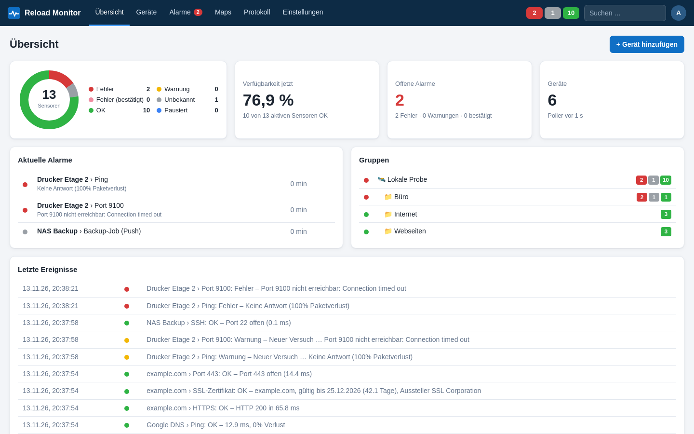 | 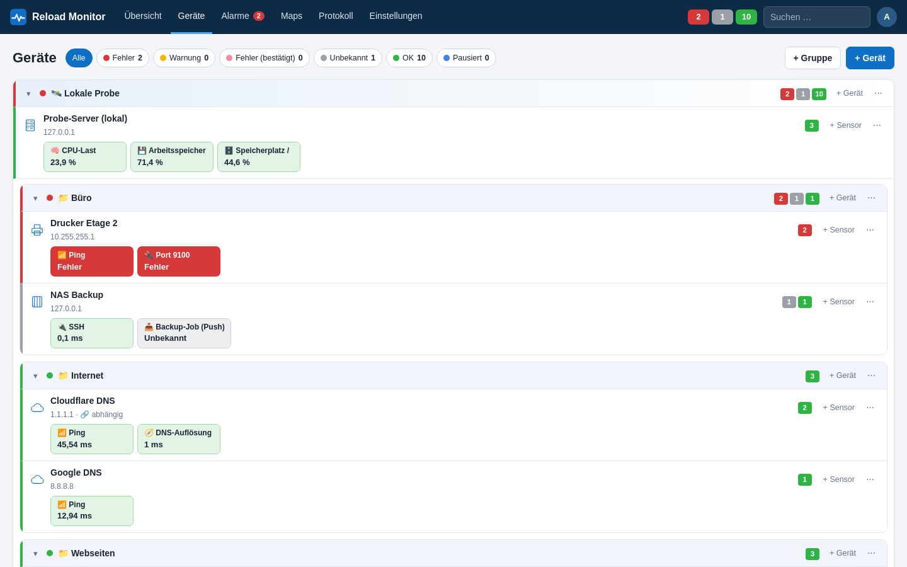 |
| Übersicht | Gerätebaum mit Sensor-Kacheln |
| 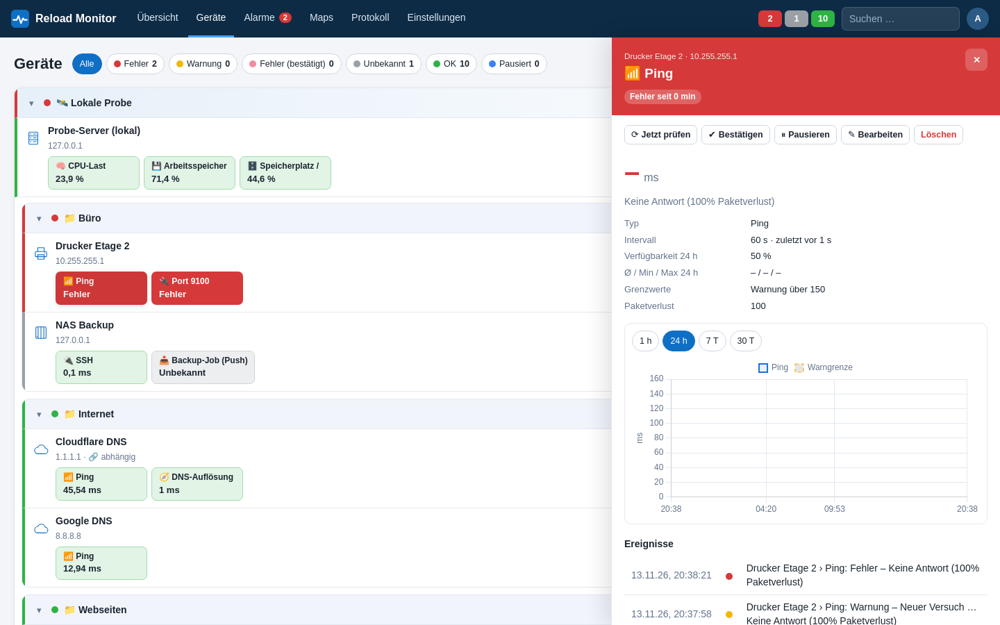 |  |
| Sensor-Details mit Graph | Alarme |
| 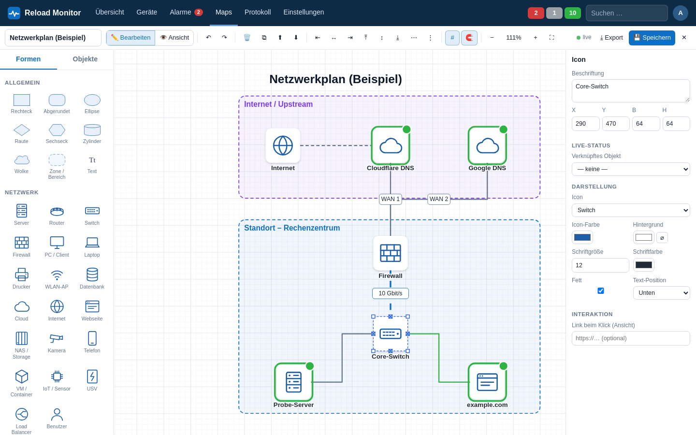 | 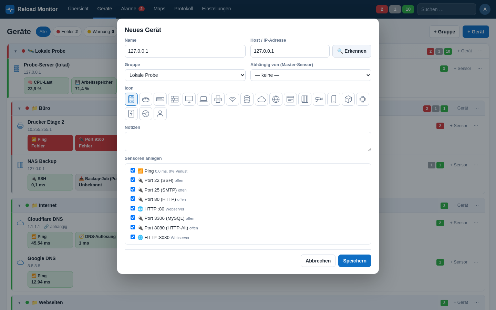 |
| Map-Editor (Bearbeiten) | Gerät anlegen mit Auto-Discovery |
| 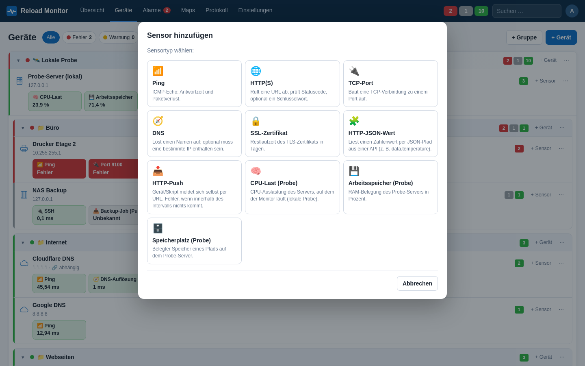 | 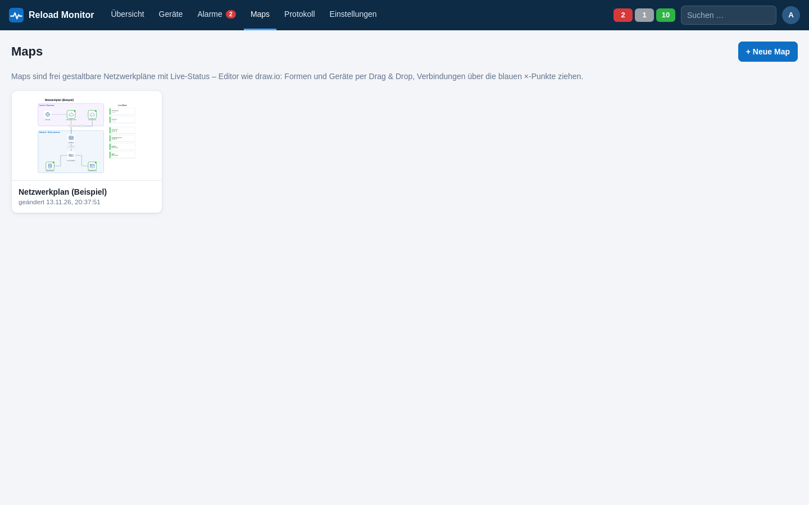 |
| Sensortypen | Maps-Übersicht |
| 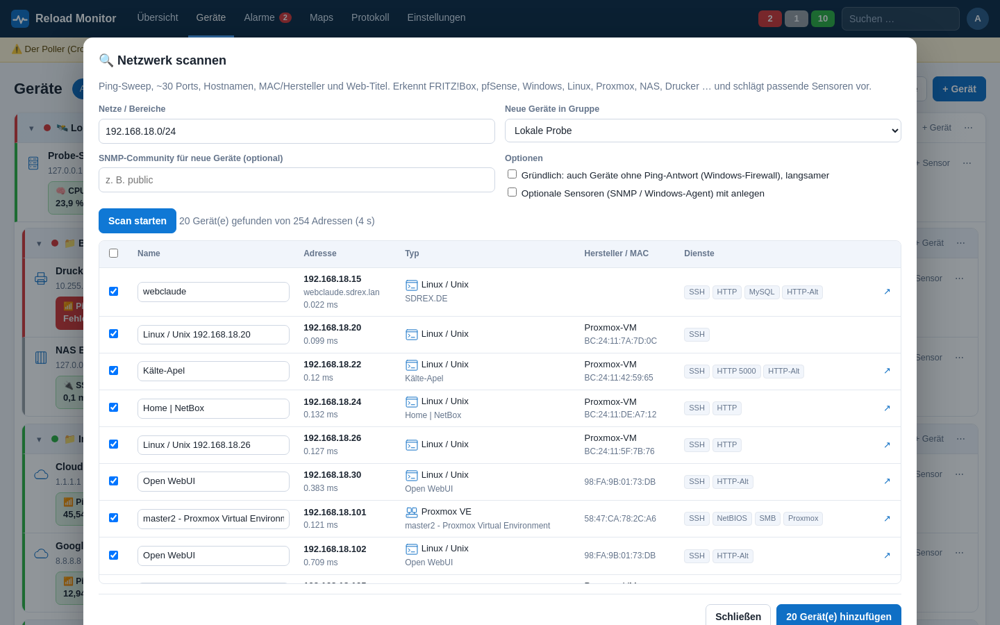 | 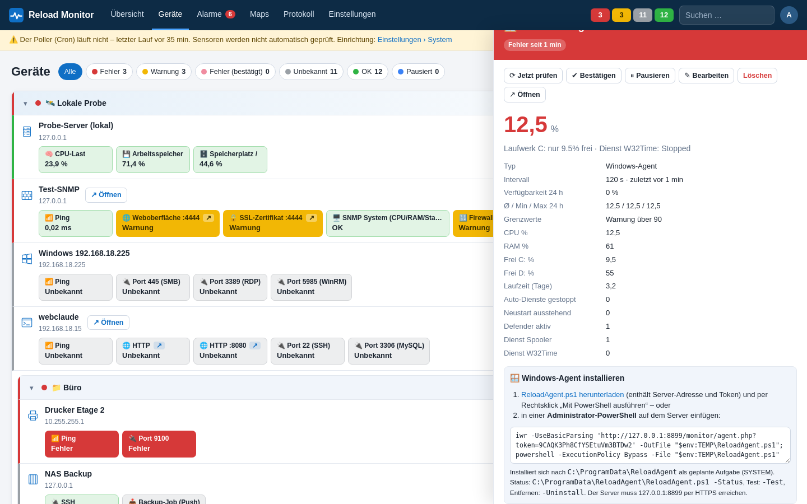 |
| Netzwerkscanner | Windows-Agent mit Kanälen |
| 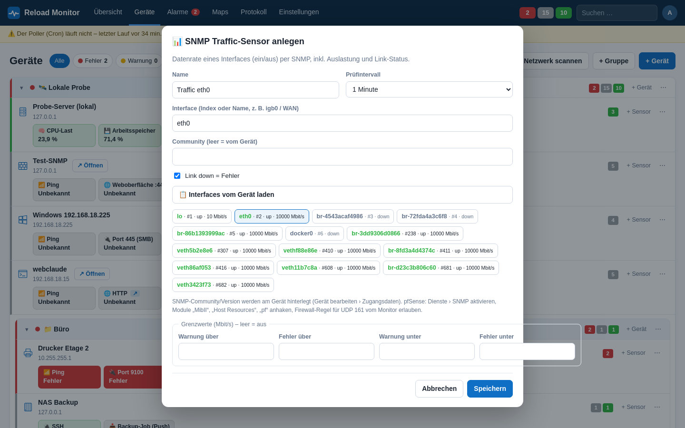 | 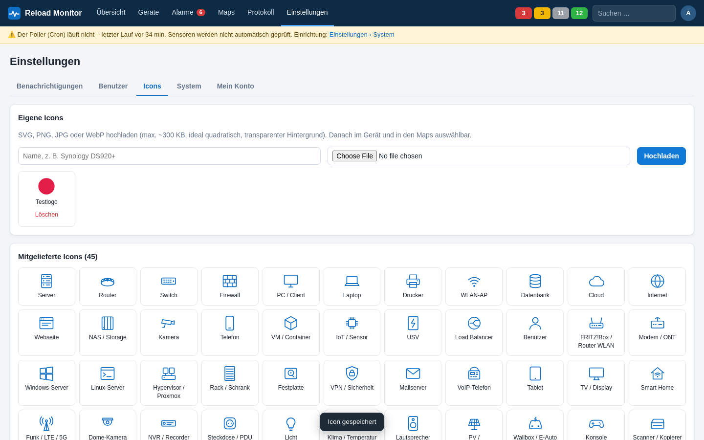 |
| SNMP-Interfaces laden | Eigene Icons |
| 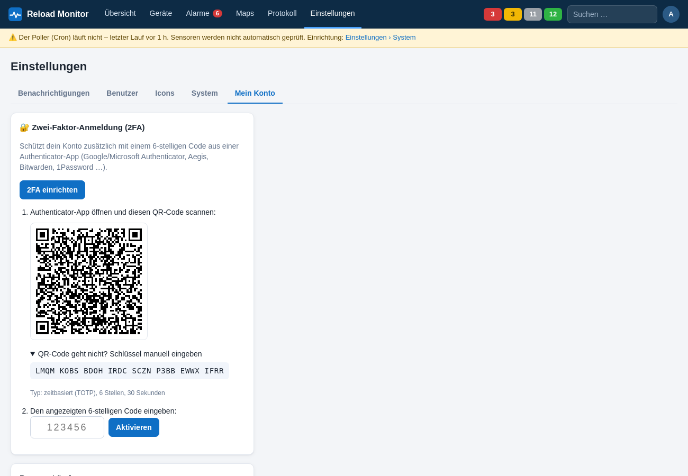 | 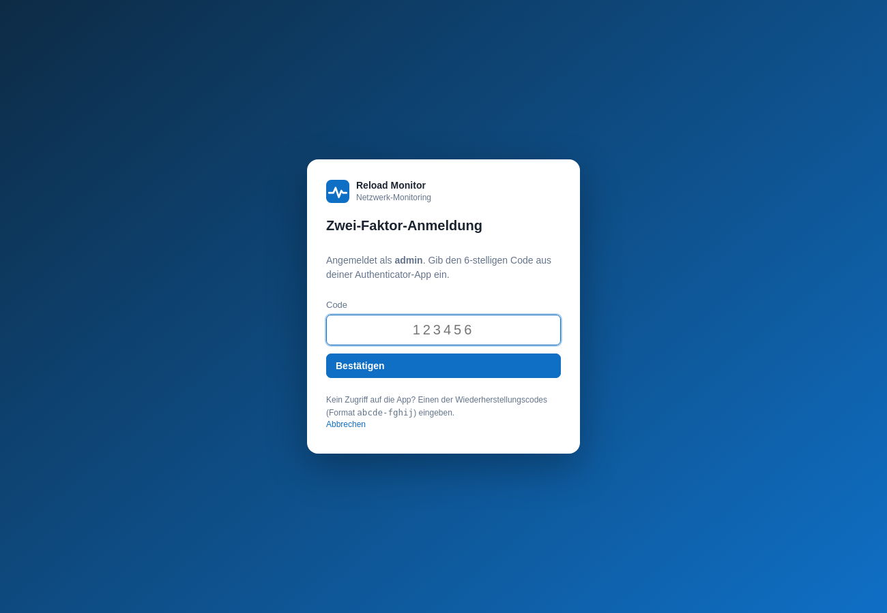 |
| 2FA einrichten | Anmeldung mit 2FA |

## Aufbau

```
index.php        SPA-Shell (Login nötig)
api.php          JSON-API der Oberfläche (Session + CSRF)
push.php         HTTP-Push-Endpunkt für Push-Sensoren (Token)
map.php          öffentliche Live-Map (Token-Link, ohne Login)
public.php       Daten für öffentliche Maps (nur Objekte der Map)
setup.php        Ersteinrichtung (Admin + optional Beispieldaten), danach gesperrt
login.php / logout.php
agent.php        liefert den Windows-Agenten mit eingesetzter URL + Token aus
agent/           ReloadAgent.ps1 (Vorlage, per .htaccess gesperrt)
cron/poller.php  Probe: prüft fällige Sensoren parallel (pcntl_fork), per Cron jede Minute
lib/             bootstrap (Config/Auth/Helfer), db (Schema + Migrationen), sensors (Typen + Prüfungen),
                 engine (Status/Baum/Retry), notify (Benachrichtigungen), snmp (SNMP v1/v2c in reinem PHP),
                 scanner (Netzwerkscanner + Geräteerkennung)
assets/          app.js (Oberfläche), mapeditor.js (Map-Editor), icons.js, app.css
data/            SQLite-Datenbank (nicht im Git, per .htaccess gesperrt)
```

Datenmodell (SQLite): `groups`, `devices`, `sensors`, `results` (Messwerte), `events` (Protokoll),
`notifications`, `maps` (Map als JSON: `nodes`, `edges`, `settings`), `users`, `settings`.

## Installation

Voraussetzungen: PHP ≥ 8.1 mit `pdo_sqlite`, `curl`, `openssl`, optional `pcntl` (parallele Prüfungen); `ping` im System; Apache (oder nginx – dann `data/`, `lib/`, `cron/` selbst sperren).

```bash
cd /var/www/html/maik
git clone git@github.com:sdrexde/prtg_reload.git monitor
chown -R www-data:www-data monitor
chmod 770 monitor/data

# Poller jede Minute als www-data
echo '* * * * * www-data php /var/www/html/maik/monitor/cron/poller.php >/dev/null 2>&1' > /etc/cron.d/reload-monitor
```

Dann `https://<domain>/monitor/` aufrufen → Ersteinrichtung (Admin-Konto anlegen).
Die App läuft in jedem Unterordner (Session-Cookie-Pfad wird automatisch ermittelt).

Manueller Poller-Test: `sudo -u www-data php cron/poller.php --once --verbose`

### Eigener LXC (empfohlen für Netzwerk-Monitoring)

Damit der Monitor alle Netze erreicht, am besten auf einem eigenen LXC/VM betreiben und diesen in der Firewall freischalten.

**1. LXC anlegen** (Proxmox): Debian 13, 1 vCPU, 512 MB–1 GB RAM, 4 GB Disk, feste IP. Unprivilegiert reicht.

**2. Code holen** – auf dem LXC einen Deploy-Key erzeugen und auf GitHub eintragen (Settings › Deploy keys, *ohne* Schreibrecht):

```bash
apt-get update && apt-get install -y git
ssh-keygen -t ed25519 -N "" -f ~/.ssh/id_ed25519 && cat ~/.ssh/id_ed25519.pub   # → als Deploy-Key eintragen
# falls Port 22 nach außen gesperrt ist: SSH über Port 443
printf 'Host github.com\n  HostName ssh.github.com\n  Port 443\n' >> ~/.ssh/config
git clone git@github.com:sdrexde/prtg_reload.git /var/www/reload-monitor
```

**3. Daten vom alten Server sichern und kopieren**

```bash
# alter Server
bash /var/www/html/maik/monitor/tools/backup.sh /root/reload-monitor.sqlite
scp /root/reload-monitor.sqlite root@<LXC-IP>:/root/
```

**4. Installieren** (Apache, PHP, vHost auf `/`, Cron, Rechte, ping für www-data, Datenübernahme):

```bash
bash /var/www/reload-monitor/install/install.sh --import /root/reload-monitor.sqlite
```

Ohne `--import` startet eine leere Installation mit Ersteinrichtung.

**5. Danach**
- Reverse-Proxy (z. B. HAProxy) auf die LXC-IP Port 80 zeigen lassen (HTTPS terminiert am Proxy). Wichtig: Der Proxy muss
  `X-Forwarded-Proto: https` setzen, sonst bekommen Windows-Agenten eine http-URL.
- Windows-Agenten: Bleibt die Adresse (z. B. nexus.sdrex.de/monitor → neue Domain), müssen sie neu heruntergeladen werden,
  sonst melden sie weiter an die alte URL. Gleiche URL beibehalten = nichts zu tun.
- Alten Server abschalten: `rm /etc/cron.d/reload-monitor` (sonst prüfen beide).

**6. Firewall (pfSense)** – Alias `Monitor` = LXC-IP, auf allen Interfaces mit zu überwachenden Netzen erlauben:

| Quelle | Ziel | Port | Zweck |
|---|---|---|---|
| Monitor | überwachte Netze | ICMP Echo | Ping, Netzwerkscan |
| Monitor | überwachte Netze | TCP (beliebig oder Port-Alias) | Port-/HTTP(S)-Sensoren, Scan, TR-064 (49000) |
| Monitor | überwachte Netze + This Firewall | UDP 161 | SNMP |
| Monitor | This Firewall | TCP 4444 | pfSense-Weboberfläche |
| Windows-Server | Monitor-URL | TCP 443 | Windows-Agent |

### Update per Deploy-Key

```bash
cd /var/www/html/maik/monitor && git pull && chown -R www-data:www-data .
```

## Windows-Server (Agent)

Wie bei Spurwerk: Sensor **„Windows-Agent“** am Gerät anlegen (oder Vorlage „Windows-Server“ / „Domänencontroller“) →
in den Sensor-Details **ReloadAgent.ps1 herunterladen** (Server-Adresse + Token sind eingesetzt) → auf dem Server
per Rechtsklick „Mit PowerShell ausführen“ oder den angezeigten Einzeiler in einer Administrator-PowerShell einfügen.

Der Agent installiert sich nach `C:\ProgramData\ReloadAgent`, läuft als geplante Aufgabe unter SYSTEM und meldet:
CPU %, RAM %, freier Speicher je Laufwerk (% und GB), Laufzeit, Prozesse, gestoppte Auto-Dienste, überwachte Dienste
(im Sensor eintragen, z. B. `NTDS,DNS,MSSQLSERVER`), Neustart ausstehend, Fehler in der Ereignisanzeige (1 h),
Tage seit letztem Update, Defender-Status/Signaturalter, Netzwerk ein/aus. Grenzen für Laufwerke im Sensor einstellbar.

```powershell
C:\ProgramData\ReloadAgent\ReloadAgent.ps1 -Status     # Zustand + Log
C:\ProgramData\ReloadAgent\ReloadAgent.ps1 -Test       # Werte anzeigen und senden
C:\ProgramData\ReloadAgent\ReloadAgent.ps1 -Uninstall  # entfernen
```

## pfSense / OPNsense (SNMP)

pfSense: **Services › SNMP** aktivieren, Community setzen, Module *MibII*, *Host Resources* und *pf* anhaken, an das
LAN-Interface binden und eine Firewall-Regel für **UDP 161** vom Monitor-Server erlauben. Im Monitor die Community am Gerät
(Zugangsdaten) hinterlegen und die Vorlage **pfSense** nutzen (Web-Port z. B. 4444). Traffic-Sensoren: Sensor
„SNMP Traffic“ → „Interfaces vom Gerät laden“ → WAN/LAN wählen.

## FRITZ!Box (TR-064)

In der FRITZ!Box **Heimnetz › Netzwerk › Netzwerkeinstellungen**: „Zugriff für Anwendungen zulassen“ und
„Statusinformationen über UPnP übertragen“ aktivieren. Damit liefert der Sensor Internet-Status, externe IP, aktuelle
Up-/Download-Rate und Sync-Raten. Mit Benutzer/Passwort am Gerät zusätzlich Modell, FRITZ!OS-Version, Laufzeit und
Anzahl bekannter Geräte. Repeater/IP-Client: Vorlage „FRITZ!Repeater“ (ohne Internet-Prüfung).

> Hinweis: Der Monitor muss die Geräte im Netz erreichen (SNMP UDP 161, TR-064 TCP 49000). Für Standorte ohne direkte
> Verbindung: VPN/Routing oder (geplant) Remote-Probe. Der Windows-Agent funktioniert überall, wo der Server den
> Monitor per HTTPS erreicht.

## Sicherheit / 2FA

- **2FA einrichten:** Einstellungen › Mein Konto › „2FA einrichten“ → QR-Code mit der Authenticator-App scannen → Code eingeben →
  10 Wiederherstellungscodes sicher aufbewahren (jeder funktioniert einmal).
- **2FA für alle vorschreiben:** Einstellungen › System › Sicherheit. Benutzer ohne 2FA müssen sie bei der nächsten Anmeldung einrichten.
- **Admin-Reset:** Einstellungen › Benutzer › „2FA zurücksetzen“ (z. B. neues Handy).
- **Notfall auf dem Server** (Admin hat Handy und Codes verloren):

```bash
cd /var/www/reload-monitor   # bzw. /var/www/html/maik/monitor
su -s /bin/sh www-data -c "php tools/user-admin.php list"
su -s /bin/sh www-data -c "php tools/user-admin.php reset-2fa admin"
su -s /bin/sh www-data -c "php tools/user-admin.php unlock"            # Anmeldesperren aufheben
su -s /bin/sh www-data -c "php tools/user-admin.php set-password admin 'NeuesPasswort'"
```

Hinweis: Die Anmeldesperre zählt pro Client-IP. Hinter einem Reverse-Proxy muss `mod_remoteip` die echte IP liefern
(macht `install/install.sh` automatisch), sonst teilen sich alle Benutzer die Proxy-IP.

## HTTP-Push

Push-Sensoren bekommen eine eigene URL (in den Sensor-Details sichtbar):

```bash
curl "https://<domain>/monitor/push.php?token=TOKEN&value=42&status=up&msg=Backup%20ok"
```

`status` = `up` | `warning` | `down`, `value` optional (Zahl, Grenzwerte greifen), `msg` optional.
Kommt innerhalb des Intervalls keine Meldung, geht der Sensor auf **Fehler** – ideal für Backup-Jobs, Cronjobs, Skripte in anderen Netzen.

## Roadmap

- SNMPv3, Linux-Agent, SSH-Sensoren
- Remote-Probes (eigener Poller an anderem Standort, meldet an den Core)
- Map-Rotation, Graph-/Tabellen-Elemente in Maps, Hintergrundbild-Upload
- Berichte (PDF), Wartungsfenster, Benachrichtigungs-Verzögerung/Eskalation
- REST-API mit Token für externe Tools
