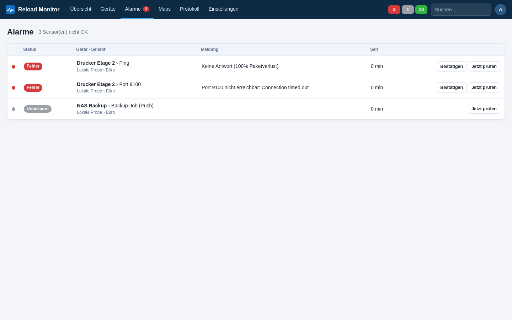

# Reload Monitor

Schlankes, selbst gehostetes **Netzwerk-Monitoring im Stil von PRTG** – mit einem **Map-Editor, der sich wie draw.io bedienen lässt**.
PHP 8 + SQLite + Vanilla JS, keine Build-Tools, kein Framework.


## Funktionen

- **Objektbaum wie PRTG:** Root → Probe → Gruppen (beliebig tief) → Geräte → Sensoren → Kanäle
- **Status-Logik wie PRTG:** Fehler / Warnung / bestätigt / unbekannt / OK / pausiert, schlimmster Status vererbt sich nach oben, Retry (1. Fehlschlag = Warnung, 2. = Fehler), Warn-/Fehlergrenzen, Abhängigkeiten (Master-Sensor), Alarme bestätigen, Pausieren
- **Sensortypen:** Ping, HTTP(S) (Statuscode, Schlüsselwort), TCP-Port, DNS, SSL-Zertifikatslaufzeit, HTTP-JSON-Wert (beliebige API), HTTP-Push (Gerät meldet sich selbst), CPU / RAM / Speicherplatz der Probe
- **Auto-Discovery:** Host eingeben → Ping + 20 gängige Ports werden geprüft und passende Sensoren vorgeschlagen
- **Graphen** (1 h / 24 h / 7 T / 30 T) mit Grenzwert-Linien, Verfügbarkeit, Ø/Min/Max
- **Benachrichtigungen:** E-Mail, Telegram, Webhook (JSON), ntfy-Push – je für Fehler / Warnung / wieder OK
- **Maps (draw.io-Bedienung):** Formen, Zonen, 20 Netzwerk-Icons, Geräte/Gruppen/Sensoren per Drag & Drop mit Live-Status, Verbinder (gerade/orthogonal/kurvig) mit Wegpunkten, Linien färben sich nach Status (zweifarbig wie PRTG), Zoom/Pan, Raster & Hilfslinien, Mehrfachauswahl, Ausrichten/Verteilen, Undo/Redo, Copy/Paste, Export PNG/SVG/JSON, **öffentlicher Link für NOC-Wand**
- **Benutzer & Rollen:** Administrator / Nur-Lesen, CSRF-Schutz, Passwort-Hashing
- Hell/Dunkel-Modus (folgt dem System), mobil nutzbar

Ausführliche PRTG-Recherche (Aufbau, Status, Maps, Map Designer, Gegenüberstellung): **[docs/PRTG-RECHERCHE.md](docs/PRTG-RECHERCHE.md)**

## Screenshots

| | |
|---|---|
|  |  |
| Übersicht | Gerätebaum mit Sensor-Kacheln |
|  |  |
| Sensor-Details mit Graph | Alarme |
|  |  |
| Map-Editor (Bearbeiten) | Gerät anlegen mit Auto-Discovery |
|  |  |
| Sensortypen | Maps-Übersicht |

## Aufbau

```
index.php        SPA-Shell (Login nötig)
api.php          JSON-API der Oberfläche (Session + CSRF)
push.php         HTTP-Push-Endpunkt für Push-Sensoren (Token)
map.php          öffentliche Live-Map (Token-Link, ohne Login)
public.php       Daten für öffentliche Maps (nur Objekte der Map)
setup.php        Ersteinrichtung (Admin + optional Beispieldaten), danach gesperrt
login.php / logout.php
cron/poller.php  Probe: prüft fällige Sensoren parallel (pcntl_fork), per Cron jede Minute
lib/             bootstrap (Config/Auth/Helfer), db (Schema), sensors (Typen + Prüfungen),
                 engine (Status/Baum/Retry), notify (Benachrichtigungen)
assets/          app.js (Oberfläche), mapeditor.js (Map-Editor), icons.js, app.css
data/            SQLite-Datenbank (nicht im Git, per .htaccess gesperrt)
```

Datenmodell (SQLite): `groups`, `devices`, `sensors`, `results` (Messwerte), `events` (Protokoll),
`notifications`, `maps` (Map als JSON: `nodes`, `edges`, `settings`), `users`, `settings`.

## Installation

Voraussetzungen: PHP ≥ 8.1 mit `pdo_sqlite`, `curl`, `openssl`, optional `pcntl` (parallele Prüfungen); `ping` im System; Apache (oder nginx – dann `data/`, `lib/`, `cron/` selbst sperren).

```bash
cd /var/www/html/maik
git clone git@github.com:sdrexde/prtg_reload.git monitor
chown -R www-data:www-data monitor
chmod 770 monitor/data

# Poller jede Minute als www-data
echo '* * * * * www-data php /var/www/html/maik/monitor/cron/poller.php >/dev/null 2>&1' > /etc/cron.d/reload-monitor
```

Dann `https://<domain>/monitor/` aufrufen → Ersteinrichtung (Admin-Konto anlegen).
Die App läuft in jedem Unterordner (Session-Cookie-Pfad wird automatisch ermittelt).

Manueller Poller-Test: `sudo -u www-data php cron/poller.php --once --verbose`

### Update per Deploy-Key

```bash
cd /var/www/html/maik/monitor && git pull && chown -R www-data:www-data .
```

## HTTP-Push

Push-Sensoren bekommen eine eigene URL (in den Sensor-Details sichtbar):

```bash
curl "https://<domain>/monitor/push.php?token=TOKEN&value=42&status=up&msg=Backup%20ok"
```

`status` = `up` | `warning` | `down`, `value` optional (Zahl, Grenzwerte greifen), `msg` optional.
Kommt innerhalb des Intervalls keine Meldung, geht der Sensor auf **Fehler** – ideal für Backup-Jobs, Cronjobs, Skripte in anderen Netzen.

## Roadmap

- SNMP (Traffic, Interfaces, Systemwerte), WMI/SSH-Sensoren
- Remote-Probes (eigener Poller an anderem Standort, meldet an den Core)
- Map-Rotation, Graph-/Tabellen-Elemente in Maps, Hintergrundbild-Upload
- Berichte (PDF), Wartungsfenster, Benachrichtigungs-Verzögerung/Eskalation
- REST-API mit Token für externe Tools
